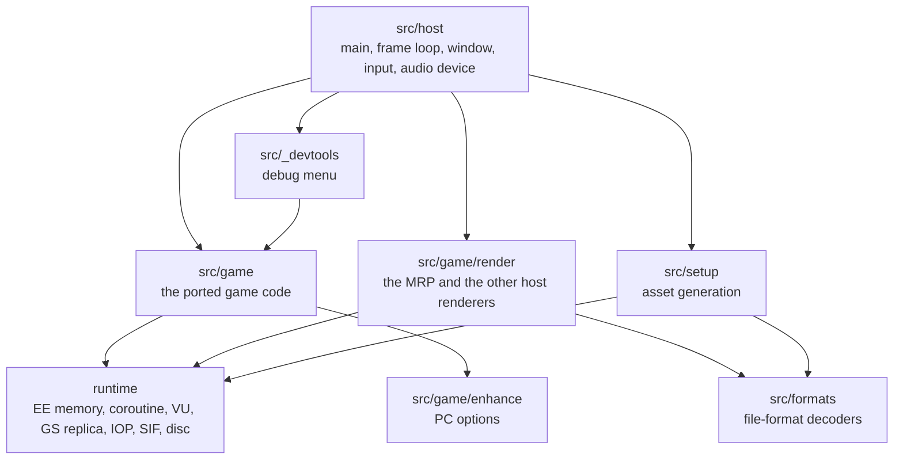

# Architecture

The source tree, what lives where, and the rules the code follows.

## The source tree

```
src/
  game/            the port: the game's code, function by function
    boot/          the boot module: intro, title screen, main menu, the start of a new game
    ovl/           the level overlay's code: game frame, mobys, hero, camera, HUD, menus,
                   weapons, VU programs, and each level's own classes
    lib/           the base executable's libraries: libc, libcdvd, libgraph, libmc,
                   libvu0, soft-float, the movie player, the 989snd EE client
    math/          the overlay's vector and matrix routines
    input/         the pad packet into the game's pad state
    render/        the host's renderer: the MRP, its lighting, level of detail and effects,
                   plus older renderers kept for comparison
    enhance/       the PC options: Graphics, Controls and Advanced pages
  formats/         decoders for the game's file formats
  io/              memory-mapped files, byte readers
  host/            main, the frame loop, window and input, audio output, test scripting
  setup/           the setup mode: ISO checks, extraction, asset generation
  _devtools/       the debug menu (openly invented, never part of the port)
runtime/           the PS2 hardware layer, no game logic
  ee/              EE: the coroutine, timer 1, float rounding, the R5900 interpreter
  vu/              VU0 and VU1, the VIF, the VU interpreter, building blocks of translated programs
  gs/              the GS replica: GS memory, packets, 2D drawing
  iop/             IOP memory, the 989snd sound driver's IOP side, audio streams
  sif/             SIF RPC between the EE and the IOP's servers
  ipu/             the movie decoder
  kernel/          EE memory and scratchpad, the memory journal, the disc, a few kernel calls
  level/           loading a level's overlay sections into EE memory
third_party/
  989snd/          OpenGOAL's reimplementation of the 989snd sound driver (ISC)
  glad/            the generated OpenGL loader
  gamecontrollerdb/ the SDL game controller database
tools/
  setup.py         the guided setup (run through setup.sh)
  overlay_match/   generates the per-level address maps from the player's disc
cmake/             dependencies downloaded at configure time
```

The build (`CMakeLists.txt`) produces one executable, `rac1-native`, from static libraries:
`rac1_formats`, `rac1_runtime`, `rac1_game`, `rac1_setup`, `rac1_devtools`, and the third-party
ones. It is C++20, built with `-Wall -Wextra -Wpedantic -frounding-math` (the last because the game's
thread runs the FPU in a non-default rounding mode, see
[Decisions](decisions.md#11-the-ees-float-rounding)). Two CMake options:

- `RAC1_MOVIES` (on by default) decodes the movies with the system's FFmpeg (`libavcodec`,
  `libavutil`) when it is found; without FFmpeg the game runs and skips the movies.
- `RAC1_DEVTOOLS` (on by default) compiles the debug menu. Even when compiled, it only opens with
  `--debug-tools` (see [Settings](settings.md#debug-tools)).

GLFW, GLM, Dear ImGui, TinyGLTF and miniaudio are downloaded by CMake at configure time, each pinned
to a release and checked against its SHA-256 (`cmake/dependencies.cmake`, `THIRD_PARTY_NOTICES.md`).

## The layers



### `src/game/`: the port

Everything that is the game lives here. Every function in `src/game/ovl`, `src/game/boot`,
`src/game/lib` and `src/game/math` carries an annotation on the line before it saying what it is;
almost all of them port one original function:

| Annotation | Meaning |
|---|---|
| `// orig: 0x00211670` | a function of the base executable or of Veldin's overlay (the reference build) |
| `// orig: L1:0x002f4348` | a function of level 1's own overlay (code that exists only there, or is built differently there); several levels can be listed |
| `// orig: front:0x001eb0a8` | a function of the boot module |
| `// orig: (host) ...`, `// orig: (helper) ...` | host code standing in for something, or a helper split out of a ported function |
| `// orig: (none) — enhancement ...` | PC-only code (the options pages and the enhancements) |

The rules a port follows are in [Overview](overview.md#the-porting-rules). In practice:

- **Game state lives in EE memory, at its original address.** The port reads and writes it through
  `ee_read` and `ee_write` (`runtime/kernel/ee_memory.h`) and the MIPS-named helpers built on them,
  `lbu`, `lh`, `lw`, `lwc1`, `sb`, `sh`, `sw`, `swc1` and so on (`src/game/ovl/ovl_common.h`).
  EE memory is a host buffer of 64 MB, of which the game uses the low 32 MB as on the PS2; the
  scratchpad is at 0x70000000. There are no C++ structs mirroring the game's records: a moby is a
  0x100-byte record read at its offsets.
- **Unported callees are stubs.** `TODO_PORT(0xADDR, "name")` (`src/game/port_stubs.h`) logs
  `[TODO_PORT] Unported call to 0x... (name) from caller: ...` once per address and caller, accepts
  any arguments, does nothing, and returns a zero value of whatever type is expected.
- **An FPU divide is `fpu_div`**, because the EE's divider rounds to nearest while the rest of its
  FPU rounds toward zero (`src/game/ovl/ovl_common.h`).
- **Machine-transliterated files.** Files named `*_tr.cpp` or `*_tr_N.cpp` (82 of them) and
  `*_asm.cpp` (34) were generated instruction by instruction from the original MIPS code by the
  project's translation tools, then proved against the original. They are not edited by hand. Their
  generators are not in this repository yet.
- **Translated VU microprograms** (`moby_vu1.cpp`, `world_vu1_*.cpp`, `particles_vu1.cpp`,
  `world_light_vu0.cpp`...) are the VU code the game uploads, translated instruction by instruction,
  in an exact form and a faster `_fast` form. They are registered by the hash of the code they
  replace and run when the game starts that code.

`src/game/render/` and `src/game/enhance/` are host code that sits beside the port: the renderer
reads the game's state and draws it; the options pages are built from the game's own menu widgets
and data. Neither changes the game's behaviour unless an enhancement is turned on.

### `runtime/`: the hardware

`runtime/` models the parts of the PS2 the game talks to, and nothing else. It takes no game decision
and knows nothing about Ratchet & Clank. It provides:

- EE memory, the scratchpad and a **journal** (`runtime/kernel/ee_journal.h`) that records writes so
  a run of ported code can be undone; the renderer uses it to run passes a second time without
  changing the game's state (see [Rendering](rendering.md#level-of-detail));
- the **coroutine** the game frame runs on (`runtime/ee/ee_thread.cpp`) and the EE's **timer 1**
  (`ee_timer.cpp`);
- the **float rounding** of the EE (`runtime/ee/ps2_fpu.h`);
- **VU0 and VU1** with the VIF and the GIF's output (`runtime/vu/`), running the translated programs
  or, for testing and fallbacks, the VU interpreter;
- the **GS replica** for the 2D (`runtime/gs/`);
- the **IOP side**: IOP memory, the SIF RPC servers the game calls, the 989snd sound driver and its
  streams (`runtime/iop/`, `runtime/sif/`);
- the **disc**, read from the player's ISO (`runtime/kernel/disc.cpp`), and the **movie decoder**
  (`runtime/ipu/`);
- the **R5900 interpreter** used to prove ports (`runtime/ee/ee_interpreter.cpp`), compiled but not
  used while playing.

### `src/_devtools/`: openly invented

The debug menu (free camera, level select, spawning, rendering switches, the light editor) is
invented code, useful for development and testing, and never presented as part of the port. Nothing
in `src/game/` or `runtime/` includes it, and `RAC1_DEVTOOLS=OFF` compiles it out.

## Per-level overlays and the `OV` macros

Each level of the game ships its own overlay: the whole engine linked again at other addresses, plus
the level's own classes and data. The same function or variable therefore sits at a different
address on many levels. For example, the overlay's main loop starts at 0x245c28 on Veldin and at
0x259c40 on Novalis, where the code is laid out differently. (Some data, such as the moby pool's
pointers at 0x15ffd8, happens to stay put.)

The ports are written against **Veldin's** addresses (level 0, the reference) and made relocatable
with the macros in `src/game/ovl/ovl_reloc.h`:

| Macro | Use |
|---|---|
| `OV(0x0015ffd8)` | a data address in the overlay (its sections, 0x15ef00 to 0x1ea300) |
| `OVF(0x00211670)` | a code address in the overlay (0x1eaa00 to 0x2f0cd0) |
| `OvConst<0x001b4950u>` | a named constant address, translated where it is used |
| `NOT_ADDR(x)` | a literal that falls in the overlay's range but is not an address (a colour, a mask) |
| `ovl_code_to_veldin(fn)` | the reverse: a level's code address back to Veldin's, to find its port |

`$gp`-relative addresses are written `OV(0x00166c00u - k)`.

**How the translation works** (`ovl_reloc.cpp`). On Veldin every macro is the identity. When a level
is loaded, `ovl_reloc_set_level` reads that level's map, `assets/generated/overlay_map/level<N>.txt`
(`front_reloc.txt` for the boot module). The maps are generated from the player's own disc during the
setup, by `tools/overlay_match/overlay_match.py` and `front_match.py`: they match each level's
functions and data to Veldin's. Each macro use site caches its translated address until the level
changes, so the cost on the hot path is one comparison.

**Dispatch.** A level's tables (class update functions, camera types, sound handlers) hold that
level's own code addresses. To find the port, the dispatchers translate the address back to Veldin's
with `ovl_code_to_veldin` and look it up in registries keyed by Veldin's addresses; code that exists
only in one level is registered under that level's own address (for example
`ovl_register_level_moby_fn` in the Novalis files). See
[Game logic](game-logic.md#mobys).

**The default.** Every level runs on its own overlay. `RAC1_OWN_OVERLAY=0` (with `--debug-tools`)
runs every level on Veldin's overlay image instead, for comparison.

## Runtime files

The game runs from the repository's root: every path is relative to the working directory.

| Path | What | Read by |
|---|---|---|
| `assets/iso/rac1-ntsc-u.iso` (or `$RAC1_ISO`) | the player's disc image | `runtime/kernel/disc.cpp` |
| `assets/dumps/SCUS_971.99` | the game's executable, extracted from the disc | `runtime/kernel/ee_memory.cpp`, `src/game/boot/front_image.cpp` |
| `assets/extracted/level_wads/<n>_<name>/level.wad` | each level's data | `src/host/orig_main.cpp`, `runtime/level/level_loader.cpp` |
| `assets/generated/overlay_map/` | the per-level address maps | `src/game/ovl/ovl_reloc.cpp` |
| `assets/generated/mrp/moby/`, `assets/generated/mrp/world/` | the MRP's assets | `mrp_moby_renderer.cpp`, `mrp_world_renderer.cpp` |
| `third_party/gamecontrollerdb/gamecontrollerdb.txt` | the controller database | `src/host/orig_main.cpp` |

All of `assets/` is generated by the setup from the player's own disc (see [Setup](setup.md)) and is
never committed. The player's own files (settings, controls, saves) live in the usual XDG
directories; see [Settings](settings.md) and [Saves](saves.md).
