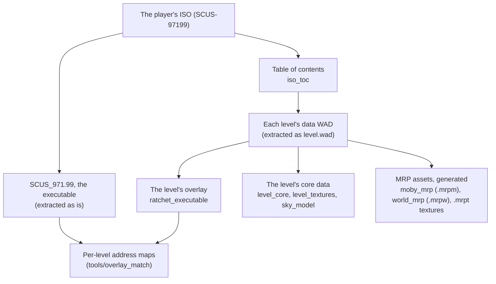

# File formats

A short index of the game's file formats the port reads, with the decoders in `src/formats/`. Nothing
here comes with the game's data: the setup extracts and generates everything from the player's own
disc (see [Setup](../setup.md)).

Most of the port does not decode the game's files at all: like the original, the ported loaders copy
a level's data into EE memory and the ported game code reads it there. The decoders below are for the
setup, the host's renderers and the overlay loader.

## The disc

**The table of contents.** Beside its ISO 9660 file system, the disc carries Insomniac's own table
of contents at sector 1500: one entry per level, giving the sectors of everything that level needs
(its data, its gameplay data for each region, its sound and music, its scenes). Decoder:
[`iso_toc`](../../src/formats/iso_toc.h). Used by the setup to find each level's data.

**The executable**, `SCUS_971.99`, is a normal PS2 ELF. The setup copies it out unchanged; the port
loads its sections into EE memory as the PS2 would. The boot module (the front end) is a section of
it.

## A level's data

**The level data WAD** (extracted to `assets/extracted/level_wads/<n>_<name>/level.wad`) holds the
level's overlay and its core data.

**The overlay** is stored as an Insomniac "Ratchet Executable": a sequence of blocks, each with a
16-byte header (the EE address to copy to, the byte count, the ELF section type it stands for, and
the overlay's entry point, repeated in every block) followed by its bytes. The base executable keeps
stub functions that the loader patches with jumps into the overlay. Decoder:
[`ratchet_executable`](../../src/formats/ratchet_executable.h); used by the level loader
(`runtime/level/level_loader.cpp`).

**The level core** is the level's main data block, compressed, with an index of its sub-assets:
moby classes, tie and shrub classes, textures, animations. Decoder:
[`level_core`](../../src/formats/level_core.h).

**Textures** are 8-bit indices into a 256-colour palette, the palette in the GS's own order (bits 3
and 4 of an index swapped) and its alpha on the GS's 0 to 0x80 scale. Decoder:
[`level_textures`](../../src/formats/level_textures.h).

**The sky** (shells and sprites) has its own small format. Decoder:
[`sky_model`](../../src/formats/sky_model.h).

**Scene WADs** group sounds and data blocks by scene, each data block compressed with the game's LZ
scheme (its decompressor is here too). Decoder: [`scene_wad`](../../src/formats/scene_wad.h).

## Models

**Moby classes**, **tie classes** and **shrub classes** are the game's model formats: packets of
vertex data laid out for the VU programs that draw them, with texture references, levels of detail
and, for mobys, skinning data and animations. The decoders
[`moby_model`](../../src/formats/moby_model.h), [`animation`](../../src/formats/animation.h),
[`tie_model`](../../src/formats/tie_model.h), [`shrub_model`](../../src/formats/shrub_model.h) and
[`level_mesh`](../../src/formats/level_mesh.h) serve the older host renderers, which are kept for
comparison. The MRP does not use them: it uses its own assets, below.

## The MRP's assets

The MRP's assets are not the game's format but the project's own, generated by the setup from the
game's data. Each keeps a model **as the game's VU program assembles it**: the setup runs the ported
VU programs on the game's packets and records what they produce, every level of detail and every mip
included. See [Rendering](../rendering.md).

| File | What | Format |
|---|---|---|
| `assets/generated/mrp/moby/level<N>/<class>.mrpm` | one moby class: its packets, their decoding, each vertex's skinning record | [`moby_mrp`](../../src/formats/moby_mrp.h) |
| `assets/generated/mrp/world/level<N>/world.mrpw` | the level's tfrags, tie classes and shrub classes, with the VU1 program's "kick program" for each | [`world_mrp`](../../src/formats/world_mrp.h) |
| `textures.mrpt`, `textures_{tfrag,tie,shrub}.mrpt` | the textures, decoded, with every mip | the same files |

`world_mrp.cpp` also holds the CPU reference of the world programs' math, which the GPU's output is
checked against.

## Decoders kept but not used

[`level_collision`](../../src/formats/level_collision.h) (the collision tree),
[`level_gameplay`](../../src/formats/level_gameplay.h) (moby placements, cameras, paths, volumes),
[`sound_bank`](../../src/formats/sound_bank.h) (989snd banks) and
[`vag`](../../src/formats/vag.h) (Sony's ADPCM sound format) are compiled, but nothing calls them:
the ported game code reads those structures in EE memory, and the sound driver reads the banks
itself.
