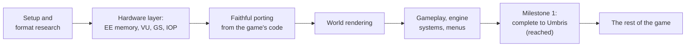

# Roadmap

Where the project has been, where it is, and what comes next. For the planet-by-planet state, see
[Status](status.md); for the story of the project in plain words, [History](history.md).

## How the project got here

1. **Setup and format research.** The disc's layout, the level containers, textures, models,
   collision and the overlays were documented, and decoders written (`src/formats/`).
2. **Hardware layer.** EE memory, the vector units, a GS replica for the 2D, the IOP's sound driver,
   the disc (`runtime/`).
3. **Faithful porting.** After early attempts to reimplement the game by observation failed, the
   project switched to porting the original code function by function, with every port proved
   against the original in an interpreter (see [Decisions](decisions.md), 2, 3 and 6).
4. **World rendering first,** so that every later port could be checked on screen; then the native
   renderer, the MRP.
5. **Gameplay, engine systems and menus:** the hero, mobys, weapons, camera, cutscenes, saves, the
   HUD, the pause and main menus, the per-level overlays.

## Milestone 1: the game complete up to Umbris (reached)

**Goal:** the game complete from the start to Umbris. **This milestone is reached.** Up to Umbris the planets can be visited in
different orders; after Umbris the story sends the player to Batalia.

**Planets in scope:** Veldin, Novalis, Aridia, Kerwan, Eudora, Rilgar, Blarg / Nebula G34 and Umbris.
The code and the game name some levels differently; see the [table of level names](status.md#level-names).

**What was asked of a planet:**

1. It is complete in play: from the arrival to every exit, with its missions, gold bolts, the
   Vendor, its secrets and special sections (the ship, Clank, the hoverboard races).
2. A full play-through reaches no `TODO_PORT` stub (checked automatically).
3. Every class of the level is ported and proved by the oracle.
4. A human playtest passes.

The known issues in [Status](status.md) are the places where a planet still falls short of this list.

**PC features that are part of the milestone:**

1. The debug tools only with `--debug-tools`; otherwise the player gets the game with the MRP.
2. Keyboard, mouse and controller support with a controller database, and a remapping page in
   Options.
3. A Graphics page: window or fullscreen, resolution, render scale, aspect ratio (4:3, 16:9 or
   filling the screen, with black bars or stretched), level of detail, field of view.
4. An "Original mode / Modern mode" choice at New Game.

All of these are implemented. A few known issues remain on the milestone's planets (listed per planet
in [Status](status.md)); they are fixes to make, not missing parts of the milestone.

**After the milestone:** the development repository is reorganised (old renderers and dead paths
removed), the documentation rewritten, and this public repository created with only what is needed
to build and play, plus the documentation.

## After Milestone 1

No later milestone has been defined in detail yet. The planned work, in no fixed order:

- **The rest of the game:** levels 8 to 18, the remaining weapons and gadgets, cutscenes and
  minigames, up to the ending.
- **Shared stubs:** the remaining `TODO_PORT` stubs every level reaches.
- **The renderer:** the HUD, menus and remaining effects drawn natively, the mobys' shadow meshes.

Ideas for later, from the project's list of [enhancements](enhancements.md) (each one optional and
off by default when it changes the game):

- a widescreen HUD, laid out to use the extra width;
- higher frame rates by interpolating between the game's 60 Hz frames (the game's logic stays at
  60 Hz);
- HD textures, generated on the player's own machine from their own disc, never distributed;
- post-processing effects;
- a language switch with all the languages on the disc;
- optional revival of content the game carries but never shows;
- Windows and macOS builds (the plan: [Platforms](platforms.md));
- the PAL release (50 Hz timing, different addresses), only once the NTSC-U version is complete;
- other graphics backends (Vulkan, Metal) behind the renderer's interface.

## Not goals

- **A matching decompilation.** The code is rewritten as readable C++, not shaped to reproduce the
  original binary.
- **A full-system PS2 emulator.** PCSX2 exists. A targeted VU interpreter for not-yet-ported
  microcode is in scope, and temporary.
- **Distributing the game's assets.** Never. Everything is generated from the player's own disc.
- **The other Ratchet & Clank games** before this one is far along.
